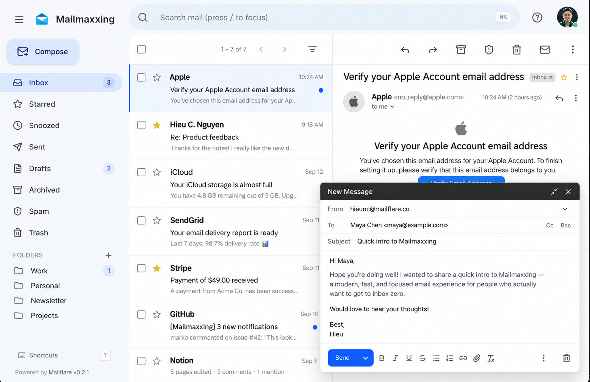
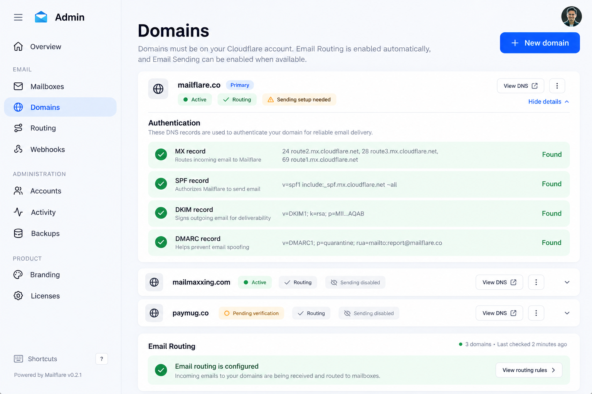
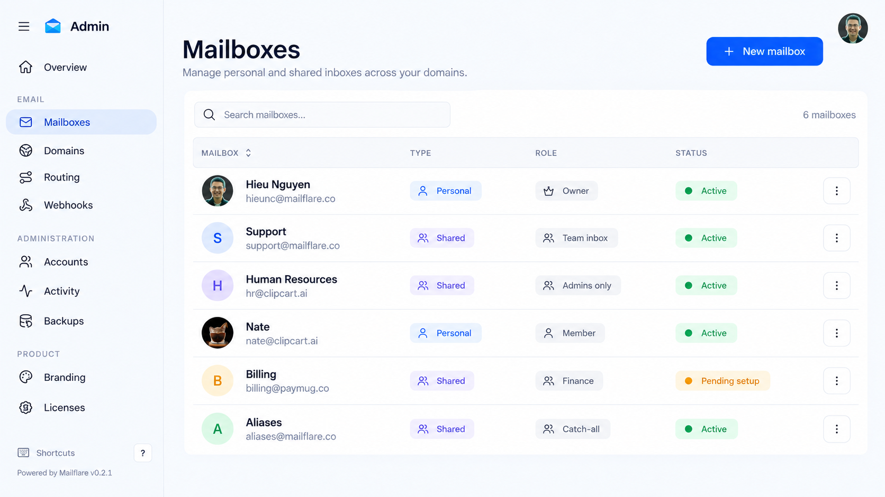

# Qimail · 其意邮箱

其意邮箱（Qimail）is a self-hosted email inbox for custom domains, built on Cloudflare. Supports **Resend**, or **AWS SES**

[](https://deploy.workers.cloudflare.com/?url=https://github.com/liruqi/qimail)

## Screenshots

| <br>Inbox | <br>Manage domains | <br>Manage inboxes |
| --- | --- | --- |

## What you can do

- **Domains**: Connect your Cloudflare domains and choose Cloudflare, Resend, or Amazon SES for each.
- **Mailboxes**: Create personal or shared mailboxes and give other people access to them.
- **Email**: Send and receive mail with attachments, rich text, signatures, and automatic replies.
- **Calendar**: Schedule repeating events with time zones and attendees, who receive email invitations.
- **Booking pages**: Share a public link so anyone can book a free time on your calendar.
- **Organization**: Keep your inbox tidy with search, folders, stars, snooze, archive, spam, and trash.
- **Routing rules**: Store, forward, reject, or sort incoming mail automatically.
- **Notifications**: Get live inbox updates and alerts when new mail arrives.
- **Import, export, contacts**: Move mail in and out, manage contacts, and block unwanted senders.
- **Admin**: Manage users, permissions, API keys, webhooks, audit logs, and backups.
- **Free allowance and paid time**: three messages a day go out on the deployment's own provider; beyond that an account can bring its own key or buy sending time. Paid time is sold month by month through **支付宝 Vibe Pay** (Alipay), see [Selling sending time](#selling-sending-time).
- **AI assistant**: Search your mail, draft replies, and manage calendar events with AI.
- **MCP access**: Connect AI clients over MCP, with separate permissions for each key.
- **Languages**: Use the interface in 34 languages: English, Português (Brasil), Português (Portugal), Español, Français, Deutsch, Italiano, Nederlands, Polski, Українська, Русский, Türkçe, 中文（简体）, 日本語, 한국어, Bahasa Indonesia, Bahasa Melayu, Tiếng Việt, ไทย, हिन्दी, বাংলা, मराठी, తెలుగు, தமிழ், ગુજરાતી, ಕನ್ನಡ, മലയാളം, ਪੰਜਾਬੀ, සිංහල, Kiswahili, Hausa, plus العربية, اردو and فارسی (right-to-left).

## How it works

Qimail runs in your Cloudflare account. By default, Cloudflare Email Routing delivers incoming mail to the app, and Cloudflare's email service sends outgoing mail. Each domain can also receive or send through Resend or Amazon SES. Cloudflare still manages the DNS.

Your mail stays in your own D1 database (or PostgreSQL, MySQL or libSQL if you set `DATABASE_URL`; see [Databases](docs/databases.md)), and attachments stay in your own R2, Backblaze B2 or AWS S3 bucket, whichever provider you use. See [Sending and receiving providers](docs/providers.md).

## Cost

**You can set up Qimail, receive mail, and send mail for free.** Receiving with Cloudflare Email Routing is free. For sending, use the free tier of Resend or Amazon SES. Cloudflare's own email sending needs a paid Worker plan.

| Send with | Free tier | After that |
| --- | --- | --- |
| **Resend** | 3,000 emails a month (100 a day), 3 domains | From $20/month for 50,000 emails |
| **Amazon SES** | $200 AWS credit for new accounts (about 2 million emails). The free plan lasts 6 months and credits expire after 12. | $0.10 per 1,000 emails |
| **Cloudflare Email Sending** | None | Needs a [Paid Worker](https://developers.cloudflare.com/workers/platform/pricing/) plan ($5/month) |

Receiving costs:

- Cloudflare Email Routing: free.
- Resend: included in every plan.
- Amazon SES: $0.10 per 1,000 messages, plus small S3 and SNS charges.

New SES accounts start in a sandbox that only delivers to verified addresses. Request production access in the AWS console to lift this.

You choose the provider per domain and can switch anytime (see [Sending and receiving providers](docs/providers.md)). Prices change, so check [Resend](https://resend.com/pricing), [Amazon SES](https://aws.amazon.com/ses/pricing/), and [Cloudflare](https://developers.cloudflare.com/workers/platform/pricing/) first.

## Deploy

1. **Deploy the app.** Click **Deploy to Cloudflare**. Keep the app name `qimail`. Other Worker names will break the app.
2. **Finish setup.** Open the deployed app and follow `/setup` to check the install and create your admin account.
3. **Connect a domain.** Add a domain from the same Cloudflare account and choose which service receives its mail. Qimail sets up Email Routing, or guides you through Resend or Amazon SES. Then create your first mailbox. Add Resend or AWS credentials on the domain page when you need them.

⚠️ **`CF_TOKEN` is required during deployment.** Create a scoped [Cloudflare API token with these permissions](https://github.com/liruqi/qimail/issues/24#issuecomment-5523686105) for the domains you want to connect:

- All accounts: Email Sending:Edit, DNS Settings:Edit, Email Routing Addresses:Edit
- All zones: DNS Settings:Edit, Email Routing Rules:Edit, Zone Settings:Edit, DNS:Edit

### Deploy with an AI coding agent

Paste the prompt below into an agent with terminal access. Give it your Cloudflare account ID and **two separate scoped API tokens** through the agent's secret input. Never put them in a public chat, repository, or committed file.

- **Deployment token** (Wrangler uses it as `CLOUDFLARE_API_TOKEN`): scope it to the target account with **Workers Scripts Edit** (or **Workers Admin** if you see Cloudflare's newer roles), **D1 Edit**, **Workers R2 Storage Edit**, **Queues Edit**, and **Account Settings Read**. Add **Workers Routes Edit** for the target zone only if the agent should attach a custom domain or route. See Cloudflare's [token permissions](https://developers.cloudflare.com/fundamentals/api/reference/permissions/) and [Workers roles](https://developers.cloudflare.com/workers/authorization/workers/).
- **Runtime token** (stored as the Worker secret `CF_TOKEN`): use the domain permissions above. Add **Email Sending Edit** to send mail. It must cover the zones you will connect in Qimail.

```text
Install Qimail from https://github.com/liruqi/qimail in my Cloudflare account.
Ask me for my Cloudflare account ID, a scoped deployment API token, and a separate
runtime CF_TOKEN through a secret input. Never print, commit, or place either token
in a command argument or a tracked file. Use the deployment token only for Wrangler
authentication (CLOUDFLARE_API_TOKEN and CLOUDFLARE_ACCOUNT_ID).

Read README.md, docs/deployment.md, and wrangler.jsonc first. Keep the Worker name
exactly qimail. In the selected account, create or reuse the D1 database
qimail, R2 bucket qimail-raw, and Queues qimail-inbound,
qimail-outbound, and qimail-agent. Set the D1 database_id in the local
Wrangler config without committing that account-specific ID. Install dependencies,
run npm run deploy, and set the runtime CF_TOKEN as a Worker secret. Do not run
remote D1 migrations manually; the /setup flow initializes the database.

Give me the deployed URL and any remaining Cloudflare account actions. I will
open /setup, create the first admin account, and connect my domain there.
```

See the [deployment guide](docs/deployment.md) for permissions, manual deployment, backups, and updates.

### Self-host with Docker

Qimail also runs as one container on any server. It uses SQLite and local files instead of D1 and R2 (Backblaze B2 can replace the local files).

- **Inbound mail**: a built-in SMTP listener, or a small Cloudflare relay Worker if you want to keep MX on Cloudflare.
- **Outbound mail**: any SMTP relay, Cloudflare Email Sending, Resend, or Amazon SES.

```bash
cp .env.docker.example .env.docker
docker compose up -d --build
```

See [docs/self-hosting.md](docs/self-hosting.md).

## Local development

```bash
cp .dev.vars.example .dev.vars
npm install
npm run db:migrate:local
npm run dev
```

Add your Cloudflare credentials to `.dev.vars`, then open [http://localhost:3000](http://localhost:3000). To load sample data, run `npm run db:seed` while the dev server is running.

The Cloudflare app uses Vite+, vinext, and the Cloudflare Vite plugin, with local D1, R2, Queues, and Durable Objects. Remote bindings are off by default. To use Workers AI locally, log in with Wrangler, set `CLOUDFLARE_ACCOUNT_ID`, and run `CLOUDFLARE_REMOTE_BINDINGS=true npm run dev`.

- Changing the database schema means a migration for each dialect: `npm run db:generate`, `db:generate:pg` and `db:generate:mysql`, then `npm run db:bundle`. See [Databases](docs/databases.md#migrations).
- `npm run build`: build the full Worker.
- `npm run start`: preview that build locally.
- `npm run deploy`: build and deploy.
- `npm run lint`: run Vite+ lint and type checks, including the existing Next.js and React rules.

The Node/Docker runtime still uses Next.js with `build:node`, `start:node`, and `dev:node`.

## Languages

Everyone can switch language from the homepage or sign-in page, and signed-in users can set it under **Settings → Account → General**, next to their time zone. The choice is kept in a cookie, so server-rendered pages use it too.

To add a language, create `public/locales/<code>.json` with the same keys as `src/lib/i18n/en.json`, then register it in `src/lib/i18n/locales.ts` with its native name (add `dir: "rtl"` for right-to-left scripts). The selector, validation, and cookie handling pick it up from that registry. Missing keys fall back to English. English ships in the main bundle; other catalogs are static assets loaded on demand, outside the Worker size limit.

## Selling sending time

A deployment can sell sending time to accounts that are not administrators. The
money is taken by Alipay through the Vibe Pay web checkout (`alipay.trade.page.pay`),
so nothing is sold until three secrets exist:

```bash
wrangler secret put ALIPAY_APP_ID          # the appId of the Alipay application
wrangler secret put ALIPAY_PRIVATE_KEY     # the application's RSA2 private key (PKCS#8, base64)
wrangler secret put ALIPAY_PUBLIC_KEY      # Alipay's public key, for verifying notifications
# optional
wrangler secret put SEND_PRICE_CNY         # price of one month, in yuan; default 6
```

With any of the first two missing, `GET /api/billing` reports `buyingOffered: false`
and `POST /api/billing/orders` answers 503 — a deployment says it does not sell
sending rather than taking money it cannot deliver on. Alipay calls back to
`/api/billing/alipay/notify`, which verifies the RSA2 signature before crediting
anything; `/api/billing/orders/<id>` and the five-minute cron query
`alipay.trade.query` as the second opinion, because a missed notification must not
cost the buyer their month.

## Credits

其意邮箱 / Qimail is a rename of [mailflare](https://github.com/hieunc229/mailflare),
which is AGPL-3.0 licensed. The upstream project is where this code started; the
sending-time billing here is not theirs.

## Documentation

- [Deployment and configuration](docs/deployment.md)
- [Databases: D1 (default), Turso/libSQL, PostgreSQL, MySQL and more](docs/databases.md)
- [Sending and receiving providers (Cloudflare, Resend, Amazon SES)](docs/providers.md)
- [API and integrations](docs/api.md), including the [calendar and booking APIs](docs/api.md#calendar-and-booking)
- [Email assistant and MCP](docs/email-assistant-and-mcp.md)
- [Troubleshooting](docs/troubleshooting.md)

## License

See [LICENSE](LICENSE).
